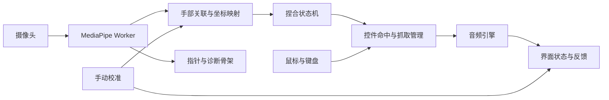

# 架构设计

实现边界与验证证据见 [进度文件](PROGRESS.md)。工程包含模拟输入、摄像头／Worker 追踪和二维单手交互实验；音频和透视仍为后续设计。目标与验收见 [项目计划](PROJECT_PLAN.md)，字段与单位见 [接口文档](INTERFACES.md)。

## 1. 路线与边界

采用 Vite＋React＋TypeScript 的小型前端应用，复用 MediaPipe 和浏览器音频能力。当前不整体 fork 完整 DJ 项目，避免把双唱盘、复杂 DSP 和部署框架一起带入单曲实验。可复用项目及许可见[研究记录](RESEARCH.md)。

单手与二维矩形面板先验证基本链路；后续必须完成手动桌面透视校准和双手同时控制音量、滤波。桌面透视可以用二维控件的投影实现，不以引入完整 3D 引擎作为完成条件。



## 2. 模块职责

目录分阶段建立。摄像头、追踪、共享类型、交互、控件与实验界面已建立；音频目录随对应阶段增加。

| 模块 | 计划位置 | 职责与边界 |
| --- | --- | --- |
| 摄像头 | `src/camera/` | 权限、视频流、实际视频设置、开始与停止；不识别手势 |
| 追踪 | `src/tracking/` | MediaPipe Worker、帧调度、结果适配、诊断；不修改音频 |
| 交互 | `src/interaction/` | 手部关联、坐标映射、捏合、指针状态；不持有音频节点 |
| 控件 | `src/controls/` | 布局、命中、抓取归属、值计算，将输入转成明确控制指令 |
| 音频 | `src/audio/` | 文件、播放、音频节点、参数平滑、真实状态；不依赖 MediaPipe |
| 界面 | `src/ui/` | 摄像头预览、控件、校准和错误提示；使用共享布局与状态 |
| 共享契约 | `src/shared/contracts.ts` | 当前阶段真正使用的公共类型，避免跨模块重复定义 |

通过直接的类型化调用与订阅连接模块。当前不需要 Redux、全局事件总线、后端服务或通用插件框架。

模拟器由用户点击生成一帧，SVG 只镜像一次；切换手数清空旧样本，重置恢复双手选择与未采样状态。模拟时间字段不进入诊断统计。

`CameraSession` 拥有视频轨道及启动代次，停止后迟到的权限结果会立即释放。`TrackingSession` 拥有 Worker、单帧闸门、视频帧回调与超时；位图采样期间也占用闸门。Worker 适配为现有 `TrackingFrame`，Canvas 直接绘制；React 每 500 ms 更新诊断，不逐帧保存关键点。

`SingleHandPointer` 消费帧和 `SurfaceMapping`，将掌部关联、捏合与平滑后的指尖转为交互事件；`ControlLab` 只消费这些事件，负责按钮与推子捕获。`LAB_LAYOUT` 同时驱动 SVG 显示和命中。`InteractionLab` 通过局部 ref 接收实时帧，只刷新自己的指针与控件快照，不将帧级状态提升到整个应用。原生后备控件同样经过控件动作，实体输入期间锁住手势。

停止、输入切换和页面隐藏释放摄像头及 Worker，迟到位图关闭、旧结果丢弃。无新结果 150 ms 清除叠层；10 秒无新画面／推理结果停止本轮并提示重试；模型加载超时为 30 秒。GPU 失败尝试 CPU，运行中降级丢弃失败帧并重置统计。统计仅保留有界直方图和计数，不保存媒体或关键点历史。

`scripts/prepare-tracking-assets.mjs` 在 dev／build 前校验固定模型摘要，复制固定 npm 包 WASM；浏览器只请求同源 `tracking/` 资源。模型与生成资源不提交，可通过命令重建；许可文件随构建分发。

## 3. 摄像头与追踪生命周期

- 请求视频而不请求麦克风。使用实际视频尺寸与设置处理坐标；理想分辨率和帧率只是请求，不是保证。
- 用新视频帧驱动识别，优先采用 `requestVideoFrameCallback`。一个 Worker 同时最多处理一帧，忙时跳过帧，不积压过时动作。
- 使用 `VIDEO` 模式。在 Worker 中调用同步的 `detectForVideo`，返回关键点与单独测量的推理耗时；释放传输的图像资源。
- 实验阶段比较 CPU／GPU；默认优先可用的 GPU，初始化或运行失败时尝试 CPU。降级后的性能也必须验证，不能因能运行就宣称达标。
- 单手阶段仍观察第二只手的干扰；双手阶段输出独立指针。模型结果的左右手分类只是提示，不是永久身份。
- 停止摄像头或离开页面时停止视频轨道、释放 Worker 和模型资源、取消抓取；停止或重启前的过时返回不得驱动新会话。
- 页面隐藏时暂停手势处理并取消抓取；不由追踪模块擅自改变音乐播放状态。恢复后先重新确认张开状态。

React 负责界面和低频状态快照，不把每一帧全部关键点写入整棵组件树。音频参数更新也不等待 React 渲染。

## 4. 坐标和桌面透视

坐标链路为：**未镜像源视频关键点 → 镜像视频内容坐标 → 面板局部坐标 → 控件值**。

- 摄像头预览使用完整内容显示，允许留黑边；坐标计算排除黑边。视频视觉镜像一次，指针映射也只转换一次，文字和控件不镜像。
- 统一使用面板局部归一化坐标：左上 `(0,0)`、右下 `(1,1)`。控件布局与音频参数不依赖当前面板在屏幕上的位置。
- MVP 使用可移动、缩放矩形；后续在 `SurfaceMapping` 内替换为四角透视变换，避免重写控件和音频。
- 四角按左上、右上、右下、左下记录在镜像视频的归一化坐标中。正变换负责渲染，逆变换负责指尖命中；不能只把控件画斜而仍按原矩形命中。
- 优先复用轻量透视库，通过小适配层生成 CSS `matrix3d` 所需矩阵，并提供反向映射。库的舍入误差、异常四边形和模块兼容性需测试。
- 校准模式使用鼠标调整并暂停手势。拒绝交叉、退化及过度压扁的四边形，保留上一次有效结果。
- 校准可保存在本机；每次开始确认机位仍匹配。相机、视频尺寸或镜像条件改变时重新确认／校准；仅窗口大小改变时，根据归一化坐标重新计算显示映射并取消当前抓取。

这里没有真实世界桌面深度、物理触碰或自动锚定。指尖悬空时仍按它在图像中的位置操作；较大高度变化可能产生视差。太低的机位会压缩远端控件，需要调整机位或面板布局。

## 5. 手势、抓取与双手

食指尖定位；拇指与食指距离按手掌尺度归一化。距离计算先处理视频宽高比，不能直接把归一化 x/y 当等长像素。闭合与张开采用不同阈值及时间防抖，指针采用轻量、与时间有关的平滑；所有参数由实验确定。

指针流程为“悬停 → 捏合按下 → 捕获移动 → 松开／取消”。初始已经捏合或丢手重现时不能触发，必须先观察到张开。按钮在原目标内松开时触发一次；推子记录抓取偏移，拖动时不会突然跳到手指位置。

单手 MVP 同时只激活一个指针。双手阶段按手腕／掌部运动连续性关联局部追踪标识，左右分类只作辅助；不把结果数组下标永久绑定到某个控件。

双手阶段规则：一个指针最多抓一个控件，一个控件最多有一个所有者；先抓取者拥有控制权，同帧冲突按确定顺序处理。任意一只手可抓任意空闲控件，不固定左手一定控制音量。

丢失或身份不明确时立即停止用旧位置更新数值，并在不超过 150 ms 的观察超时内发出取消。该时间是初始工程目标，需实测，不是已证明的效果。一只手丢失只取消自己的抓取；恢复须先张开。手交叉无法可靠关联时可取消相关抓取，但不能悄悄交换控制权。

鼠标和键盘使用同一控件动作及音频指令。实体鼠标开始拖动时取消手势抓取，在本次实体操作结束前不让手势抢回；键盘操作也应取消冲突抓取。

## 6. 音频与状态

MVP 音频链路：

```text
本地 File → Object URL → HTMLAudioElement
                         → MediaElementAudioSourceNode → GainNode → destination
```

滤波阶段在音源与音量之间加入低通 `BiquadFilterNode`，提供明确启用／旁路状态。音量与截止频率变化做短时间平滑，初始以约 20 ms 为实验值；旁路切换也检查点击杂音。

- 复用一个音频上下文、播放元素和媒体源节点，不随 React 重渲染重复创建。
- 先选文件，再通过真实点击／按键“开始体验”启用音频并尝试播放；摄像头权限在明确的启用操作中请求。摄像头不可用时保留鼠标操作。
- 不把摄像头捏合当作浏览器的用户激活。`resume()` 和 `play()` 失败时展示实际错误，不显示虚假的播放状态。
- 换曲暂停旧曲、释放旧 Object URL、重置时间，新曲处于就绪状态；快速换曲与异步返回只以最新请求为准。
- `playing`、`paused`、`ended` 等由实际媒体事件和 Promise 结果更新。一次按钮动作产生一次明确的 `setPlayback` 指令，不逐帧发送 toggle。
- 默认音量值为 0.5，归一化音量映射到 `GainNode` 的 0～1 增益；滤波默认旁路，启用后截止频率按对数映射。
- MP3 和常见 PCM WAV 是验证基线，不保证所有 WAV 编码都能解码；报告不支持格式和损坏文件。
- 不为了 MVP 把整首歌曲手动解码成自建采样缓存，也不引入搓碟 AudioWorklet。未来需要这些能力时重新评估成熟实现。

## 7. 运行、数据与验证

仅本地前端开发服务器，无账户和媒体后端。摄像头需在允许的安全上下文中使用，本地使用 `localhost`；首次依赖和模型准备可能联网，应用运行时从本地提供模型／WASM，不依赖浮动 CDN 版本。

诊断显示实际摄像头设置、追踪配置、有效结果频率、推理耗时、采样到返回耗时和取消原因。主线程采样与接收使用同一时钟；Worker 内部耗时单独传回，不能直接相减不同环境的时间原点。

手势状态与坐标用模拟数据测试，摄像头机位与实际声音用两台 Edge 实测。详细门槛集中维护在[项目计划](PROJECT_PLAN.md)，此文档不复制另一套验收数字。
